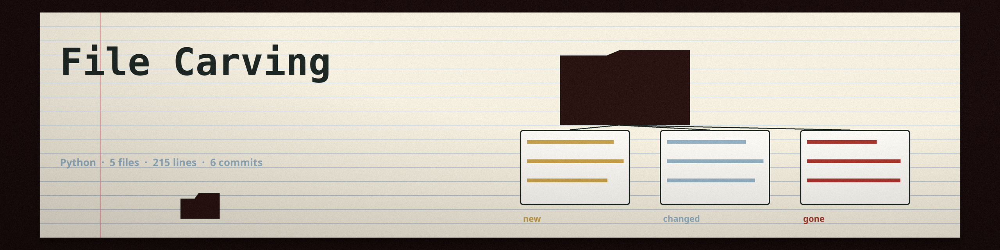

# file-carving
Recovers potentially deleted files from a raw disk image or file, based on file type headers and footers. - Focused on File operations and analysis

## Install
`git clone https://github.com/ShadowGuardAI/file-carving`

## Usage
`./file-carving [params]`

## Parameters
- `-h`: Show help message and exit
- `--blocksize`: No description provided
- `--filetypes`: No description provided
- `--log`: No description provided

## License
Copyright (c) ShadowGuardAI

A default `filetypes.txt` ships in this repo, in the format the parser expects, covering jpg, png, gif, pdf, zip, and bmp, so a run from the repo directory carves with no signature file supplied. Carved files are named with the carved type's extension, for example `.jpg`. `--blocksize` is the number of bytes carved starting at a header when no footer is defined for that type. `--log` writes the log to the named file. A header with no following footer is logged with its offset and counted as skipped. A run that carves nothing exits 1 with a plain no files carved line and no success line, and every failure path exits non-zero.
